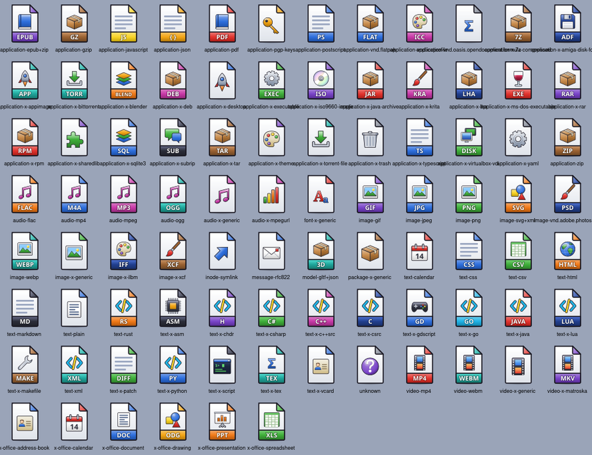
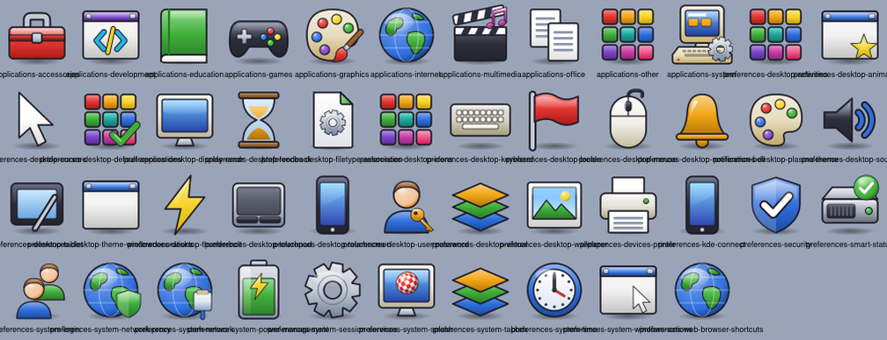
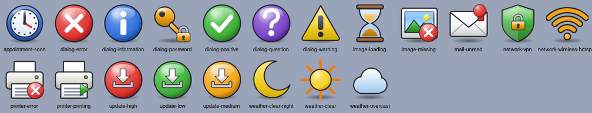
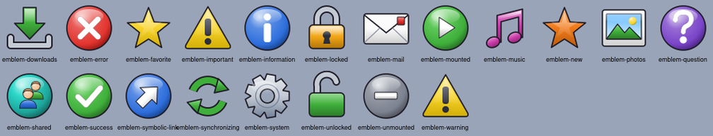

# AmigaGloss icon theme for KDE Plasma

A glossy icon theme for KDE Plasma in the spirit of the AmigaOS 4.1 Workbench look: chunky shapes, thick outlines, bright gradients and soft drop shadows.


All artwork is original. Every icon is drawn from code in Python and written out as SVG. Nothing was copied or traced from AmigaOS.

**Version:** v00.01

## What's included

- **~460 drawn icons** plus **~700 alias names**, so many apps and file types pick them up automatically
- **Places:** amber drawers with pictures for Documents, Downloads, Music, Pictures, Videos, Code and Games; 15 coloured drawers for Dolphin's "assign folder colour"; home, trash (empty and full), network, and a red/white checkered ball as the start button
- **Devices:** hard drive, SSD, floppy, CD/DVD, USB stick, SD card, keyboard, mouse, printer, scanner, monitor, laptop, a wedge home computer, and more
- **File types:** labelled documents (PDF, PY, ZIP, MP3, MKV, DOC…), including Amiga formats: ADF disk images, LHA archives and IFF pictures
- **Apps:** Dolphin, Konsole (a Shell window with a `1>` prompt), Kate, System Settings, Discover, Okular, Gwenview, Steam, Lutris, Wine, FS-UAE, VS Code and others, Blender, LibreOffice, and more
- **Settings categories, toolbar actions, dialog/status icons and file emblems**

Anything not covered falls back to **Breeze**.

## Previews

| | |
|---|---|
| Places  | Devices  |
| Apps  | File types  |
| Actions  | Categories  |
| Status  | Emblems  |

## Install

**From a release:** download `AmigaGloss-v00.01.tar.gz`, extract it into `~/.local/share/icons/`, then pick **AmigaGloss** in *System Settings → Colours & Themes → Icons*.

**From source** (needs only Python 3):

```sh
git clone https://github.com/scotbeachell-lab/amiga-gloss-icons.git
cd amiga-gloss-icons
./install.sh
/usr/libexec/plasma-changeicons AmigaGloss
```

### Start button

To get the checkered ball on your launcher, right-click it → *Configure* → click the icon → search for `start-here-amiga`. The common start-menu icon names (`start-here-kde`, `start-here-kde-symbolic`, `about_kde`) also map to the ball.

## Windows

Windows has no icon themes, so AmigaGloss can't replace every icon the way it does on KDE. It can change your user folders, drives and the Recycle Bin, and the `.ico` files work anywhere Windows asks you to pick an icon: shortcuts, pinned apps, *Properties → Customize → Change Icon* on any folder.

```powershell
git clone https://github.com/scotbeachell-lab/amiga-gloss-icons.git
cd amiga-gloss-icons
py -m venv .venv
.venv\Scripts\python -m pip install resvg-py pillow
cd gen; ..\.venv\Scripts\python build_windows.py; cd ..   # -> windows\ico\<context>\<name>.ico
.\install-windows.ps1 -DryRun     # show what would change
.\install-windows.ps1             # apply
.\install-windows.ps1 -Uninstall  # put everything back
```

The installer changes only per-user settings:

- **Folders:** Documents, Downloads, Music, Pictures, Videos and `%USERPROFILE%\GitHub` get their drawer icons through each folder's `desktop.ini`.
- **Recycle Bin:** empty and full trash cans, through the HKCU registry.
- **Drives:** SSD, hard disk, USB and optical icons per drive letter, through the HKCU registry. Windows 11's This PC view ignores these per-user drive overrides (it only honours the machine-wide `HKLM\...\Explorer\DriveIcons` key, which this script doesn't touch), so you may still see stock drive icons there.
- **Sidebar:** the pinned Documents/Downloads/... entries in Explorer's sidebar come from Windows' machine-wide known-folder registration and keep their stock icons.

The icons are copied to a hidden `%USERPROFILE%\.amigagloss\ico` folder, and everything changed is backed up next to them first. (Not `%LOCALAPPDATA%`: Explorer's folder windows silently refuse folder icons stored there.) Explorer caches icons, so if something hasn't changed, restart Explorer or sign out and back in. It never touches system files (`imageres.dll`, `shell32.dll`) or HKLM. If PowerShell refuses to run the script, use `powershell -ExecutionPolicy Bypass -File .\install-windows.ps1`.

## How it works

| File | Purpose |
|---|---|
| `gen/lib.py` | Colours, gradients, shape and gloss primitives (64×64 canvas) |
| `gen/art.py` | Pictograms and objects (drawers, disks, globe, ball…) |
| `gen/objects.py` | Composite bases: drawer, document, tile |
| `gen/build.py` | Maps KDE/freedesktop icon names to drawings, then writes the theme |
| `gen/build_windows.py` | Renders every drawn icon to a multi-size Windows `.ico` |
| `install-windows.ps1` | Applies (or removes) the icons on Windows for the current user |

To add or change an icon, add one line to `build.py`:

```python
R('apps', 'my-app org.example.MyApp', O(lambda ic: e_globe(ic) + place(e_star(ic), 34, 34, .45)))
```

The SVGs avoid filters, masks and clip paths, so Qt's SVG renderer draws them exactly like librsvg does.
